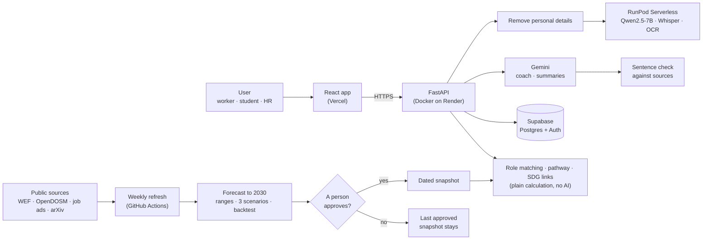

# Laluan: a career GPS for the AI era

> **Laluan** (Malay for "path") shows Malaysian workers, students and HR teams how AI could change their work, which of their skills carry over, and a costed reskilling route to roles with a better outlook, with a dated source behind every number.

**SDC Hackathon 2026 @ XMUM (#1stSDGHack)** · Team **Made in UTM** · Domain 1: The Aiversecity Future-Ready Workforce

[](https://www.youtube.com/watch?v=8IJ64e0ftos)

**▶ [Watch the pitch and demo (6:57)](https://www.youtube.com/watch?v=8IJ64e0ftos)** · **[Try the live app](https://laluan-psi.vercel.app)**


---

## Team Information

| Field | Details |
| --- | --- |
| **Team Name** | Made in UTM |
| **Team Domain** | Domain 1: The Aiversecity Future-Ready Workforce |
| **SDG Track (1–17)** | **SDG 4** Quality Education (targets 4.3, 4.4), with SDG 8 Decent Work and Economic Growth (targets 8.2, 8.5) |
| **Team Leader** | Tan Hong Sheng |
| **University** | Universiti Teknologi Malaysia (UTM) |
| **Number of Members** | 4 |

## Links

| Resource | Link |
| --- | --- |
| GitHub Repository | <https://github.com/tanhongsheng050204-code/SDC-HACKATHON-2026-XMUM---Made-In-UTM> |
| Live Demo | **<https://laluan-psi.vercel.app>** (no sign-up; API docs at <https://laluan-api.onrender.com/docs>) |
| Replit | Validation sandbox for the app; see [How We Use Replit](#how-we-use-replit-required) and the [proof of use (PDF)](submission/SDC2026_MadeInUTM_Replit_POU.pdf) |
| RunPod Endpoints | [Qwen2.5-7B CV reader](https://api.runpod.ai/v2/tkz2ystb9e77tu/runsync) · [faster-whisper voice](https://api.runpod.ai/v2/m7wj9nadqy9v82/runsync) · [OCR worker](https://api.runpod.ai/v2/lsamu8q64cbso5/runsync) (POST with the team API key); see [How We Use RunPod](#how-we-use-runpod-required) and the [proof of use (PDF)](submission/SDC2026_MadeInUTM_Runpod_POU.pdf) |
| Slide Deck | [`submission/SDC2026_MadeInUTM_PitchDeck.pdf`](submission/SDC2026_MadeInUTM_PitchDeck.pdf) (17 slides; editable [.pptx](docs/submission/Laluan_Pitch_Deck.pptx)) |
| Demo Video | **<https://www.youtube.com/watch?v=8IJ64e0ftos>** (pitch and live demo, 6:57) |
| Preliminary Proposal | [`submission/SDC2026_MadeInUTM_Preliminary.pdf`](submission/SDC2026_MadeInUTM_Preliminary.pdf) |
| Technical Tools Declaration | [`submission/SDC2026_MadeInUTM_TechDeclaration.pdf`](submission/SDC2026_MadeInUTM_TechDeclaration.pdf) |

**One-click demos** for each user group (no sign-up):

| Who | Open |
| --- | --- |
| Working adult at risk (Aisyah, data-entry clerk) | [Worker demo](https://laluan-psi.vercel.app/?demo=clerk) |
| Fresh graduate (Wei Jie) | [Graduate demo](https://laluan-psi.vercel.app/?demo=student) |
| Career switcher (Farid, call-centre agent) | [Switcher demo](https://laluan-psi.vercel.app/?demo=switcher) |
| HR and L&D team (190 synthetic staff) | [Company view](https://laluan-psi.vercel.app/?demo=hr) |
| TVET or university career centre (52 synthetic students) | [Class view](https://laluan-psi.vercel.app/?demo=class) |

> The API runs on Render's free plan. A scheduled ping keeps it awake from 07:00 to 23:00 Malaysia time; outside those hours the first click can take up to a minute, and the app says "Waking up the server…".

---

## Overview

### Problem

AI is changing which jobs exist faster than training and skills frameworks can follow. In Malaysia, 56% of professionals already use AI at work but only 26% have had formal training (Hays Asia Salary Guide 2025), and MOSTI expects more than 600,000 workers to need reskilling within three to five years. A worker like Aisyah hears that AI is coming for her job, has a few hours a week and almost no budget, and gets two bad answers: a generic career quiz, or a chatbot that sounds sure and cites nothing.

**Who it is for:** working adults at risk of displacement, fresh graduates and career switchers, HR and L&D managers, and TVET and university career centres.

### Solution

In a few minutes, Laluan turns a CV or a skill list into ranked future roles with an explainable match score and skills gap, three possible AI futures instead of one guess, an ordered plan of free or HRD Corp-claimable courses with hours and cost in RM, and how that path serves the UN SDGs. Every number traces back to a dated, public source. You make the call; Laluan shows the evidence.

AI does the reading and the explaining: an open model on RunPod reads skills from the CV after personal details are removed, Whisper on RunPod turns speech into text, and Gemini answers questions only from your own results, with every sentence checked against the sources. The route itself (matching, forecasts, scenarios and pathways) is plain calculation over approved data, so it cannot invent a job, a course or a number.

### Key Features

The six must-have features from the Domain 1 brief:

| | Requirement | How Laluan delivers it | Where to see it |
| --- | --- | --- | --- |
| 1 | **Skills profile intake** | CV upload (PDF, Word, scan or photo), pasted text, three questions, voice, or a skill list. Names, emails, phone and IC numbers, addresses and employer names are removed **before any AI reads the text**, and the person sees exactly what will be sent. | Start with my skills |
| 2 | **AI-trend signal layer** | A pipeline collects arXiv research, Malaysian job ads (freehire.me, counted per role and per skill), Hacker News hiring threads, developer attention (Stack Overflow, GitHub, npm and PyPI), AI papers carrying a Malaysian institution, and OpenDOSM's labour-force, sector-employment and price series on top of the WEF Future of Jobs 2025 baseline. Each refresh becomes a **dated snapshot**, runs weekly from GitHub Actions, and **goes live only after a person approves it**. | Future Skills Radar, Sources |
| 3 | **Future-role matching** | 23 roles ranked by *0.6 × skill fit + 0.4 × outlook*. **Why this rank?** shows the breakdown; every role lists the skills you have and the ones you're missing. | Future roles, role page |
| 4 | **Personalised pathway** | Ordered courses for the missing skills, with hours, cost label and the date each link was checked. Free-only filter; HRD Corp-claimable programmes for workers. Tick a course and readiness updates. | Pathway |
| 5 | **SDG mapping** | Every role and skill is linked to an SDG target, with a written reason for each link. Pick an SDG and Laluan shows which role serves it and what that choice costs you in fit and outlook. | SDG impact, Future roles → Any SDG |
| 6 | **Handling uncertainty** | Slow, Baseline and Fast AI adoption, a free 0.5×–2× slider, a year slider, 80% ranges, *Likely* / *Uncertain* labels and a published backtest. Every forecast is labelled an estimate. | Radar, Future roles |

<table>
<tr>
<td width="50%"><b>1 · Personal details removed before any AI reads the CV</b><br></td>
<td width="50%"><b>2 + 6 · Future Skills Radar under three AI speeds</b><br></td>
</tr>
<tr>
<td><b>3 · Ranked roles with an explainable score</b><br></td>
<td><b>4 · An ordered, costed pathway</b><br></td>
</tr>
<tr>
<td><b>5 · Choose with a goal in mind</b><br></td>
<td><b>6 · Your own AI future and tipping points</b><br></td>
</tr>
</table>

### What makes Laluan different

- **Forecast x-ray.** Tap any outlook and see every step from the published WEF figure to the number on the card: Malaysian job-ad demand, OpenDOSM employment, the monthly labour market, live postings for the role, the Malaysian sector shift, Malaysian AI research, AI research momentum and AI adoption, each with its source, snapshot and cap.
- **Your own tipping point.** Drag AI adoption from 0.5× to 2×. Laluan names the speed at which your current job turns *Declining* or another role overtakes your top match.
- **Output changes when the data changes.** When a newer forecast is approved, Today says which roles moved and offers to re-plan. Nothing switches without you.
- **Humans in charge.** A person approves every trend update (with a before/after table of every role that would move), the coach can only *suggest* a change that you then press **Apply** on, and every screen says "You decide". Laluan never ranks people for hiring.
- **A coach that checks itself.** It answers only from your own results with numbered sources. Every sentence is checked against them; unsupported ones are rewritten or removed, and the answer says so. Prompt-injection attempts get a calm refusal.
- **Fairness check.** Every sample profile and CV is run under eight names from Malaysia's communities, female and male. Rankings, scores, pathways and skills read from CVs must be identical. Shown on Sources and run in CI.
- **Built for Malaysia.** OpenDOSM pay and employment, TalentCorp MyCOL, MyMahir, HRD Corp, prices in RM, and English, Bahasa Malaysia and 中文 throughout.

<table>
<tr>
<td width="50%"><b>The coach answers from sources and checks itself</b><br></td>
<td width="50%"><b>New trend data re-ranks the roles; every snapshot is on Sources</b><br></td>
</tr>
<tr>
<td colspan="2"><b>For HR teams: risk by role and the cheapest reskilling moves, totals only</b><br></td>
</tr>
</table>

More: My job task by task, a skill tree with proof questions, interview practice, a career identity statement, live Malaysian job ads, a Future Card with QR code, progress tracking, a class view for career centres, a weekly email digest and a phone app. See **[every feature](docs/FEATURES.md)** and the **[user manual](docs/USER_MANUAL.md)**.

### Tech Stack

| Layer | Technology |
| --- | --- |
| Frontend | React 18, TypeScript, Vite; English, Bahasa Malaysia and 中文; installable phone app |
| Backend | Python 3.12, FastAPI, Pydantic, in Docker |
| Database | Supabase Postgres and Auth (SQLite for local runs); versioned JSON reference data |
| AI / Compute | **RunPod Serverless** (Qwen2.5-7B-Instruct on vLLM, faster-whisper, our own OCR worker); Google Gemini 3.8 Flash and Gemini embeddings |
| Hosting / Dev | Vercel (frontend), Render (API, Singapore), GitHub Actions (tests, weekly trend refresh); Replit (validation sandbox) |

---

## Project Structure

```
.
├── backend/                 # FastAPI API (Python 3.12)
│   ├── app/                 # api.py routes, runpod.py, llm.py, services/ (matching, pathway, coach, OCR, …)
│   ├── data/                # versioned reference data: roles, skills, courses, SDG map, trend snapshots
│   ├── scripts/             # data builders and refresh_trends.py (the trend pipeline)
│   ├── tests/               # pytest suite, run in CI on SQLite and Postgres
│   ├── Dockerfile           # the API container (Render)
│   └── .env.example         # every setting, with RunPod and Gemini keys left blank
├── frontend/                # React + TypeScript + Vite
│   ├── src/screens/         # one file per screen (Intake, Roles, Radar, Pathway, Workforce, …)
│   ├── src/components/      # shared UI
│   └── src/lib/             # API client, i18n (EN / BM / 中文), auth
├── runpod/
│   └── ocr/                 # RunPod Serverless OCR worker: handler.py, Dockerfile
├── submission/              # SDC submission PDFs (Preliminary, Tech Declaration, pitch deck, Replit and RunPod proof of use)
├── docs/                    # PRD, TRD, how it works, user manual, decisions, review log, media/ GIFs
├── .github/workflows/       # ci.yml (tests and build), cron.yml (keep-awake, weekly refresh, digests)
├── docker-compose.yml       # whole app in one command
├── render.yaml              # Render blueprint for the API
└── LICENSE                  # Apache License 2.0
```

### Architecture



The details are in **[How Laluan works](docs/HOW_IT_WORKS.md)**.

---

## How to Run

### Option 1 — Run on Replit

1. In Replit, choose **Create Repl → Import from GitHub** and paste this repository's URL.
2. Optional: add `GEMINI_API_KEY` and the `RUNPOD_*` values from [`backend/.env.example`](backend/.env.example) in the **Secrets** tab (🔒). Without them the app runs on rules and templates.
3. In the Shell, run the backend and frontend commands from Option 2 below.

### Option 2 — Run Locally

No API key is needed: without keys, Laluan reads CVs with a skills dictionary and writes text from templates.

```bash
# 1. Clone the repository
git clone https://github.com/tanhongsheng050204-code/SDC-HACKATHON-2026-XMUM---Made-In-UTM.git
cd SDC-HACKATHON-2026-XMUM---Made-In-UTM

# 2. Backend (http://localhost:8000, docs at /docs)
cd backend
python -m venv .venv
.venv/bin/pip install -r requirements-dev.txt          # Windows: .venv\Scripts\pip
cp .env.example .env                                     # optional: add GEMINI_API_KEY, RUNPOD_* keys
.venv/bin/python -m uvicorn app.main:app --port 8000

# 3. Frontend, in a second terminal (http://localhost:5173)
cd frontend
npm install
npm run dev
```

Or run the whole app with Docker: `docker compose up --build`, then open <http://localhost:8081>.

### Run Tests

```bash
cd backend && .venv/bin/python -m pytest          # about 490 backend tests
cd frontend && npm test && npm run build           # component tests, type check and build
```

CI runs both on every push, against SQLite and Postgres. Setup, configuration and deployment are in **[Developing Laluan](docs/DEVELOPMENT.md)**.

---

## How We Use Replit *(Required)*

- **Validation sandbox:** we used Replit (a Domain 1 sponsor) to test the web application in a clean cloud environment, check that the dependencies install from scratch, and confirm it runs the same way outside our own machines.
- **Replit Agent:** the proof of use shows the team's Replit account usage, including Agent (AI) use, from 20 to 24 October 2026.
- **Production stays elsewhere:** the live demo runs on Vercel and Render, so judges use the same deployment we tested.

📄 Proof of use: [`submission/SDC2026_MadeInUTM_Replit_POU.pdf`](submission/SDC2026_MadeInUTM_Replit_POU.pdf)

## How We Use RunPod *(Required)*

RunPod runs the open models, so a person's CV text and voice never have to reach Google:

| Endpoint | Workload | Code |
| --- | --- | --- |
| **CV reader** | Qwen2.5-7B-Instruct on a vLLM Serverless worker (24 GB GPU) reads skill phrases from the CV **after** names, emails, phone and IC numbers are removed | [`backend/app/runpod.py`](backend/app/runpod.py) `generate_json`, called from [`services/skills.py`](backend/app/services/skills.py) |
| **Voice input** | faster-whisper (`small`, 16 GB GPU) turns a spoken answer into text; the audio is sent once and never stored | `runpod.transcribe`, route `/api/voice/transcribe` |
| **OCR worker** | Our own worker, built by RunPod from this repository, reads scanned CVs and photos (RapidOCR with the PaddleOCR PP-OCRv4 recogniser) | [`runpod/ocr/handler.py`](runpod/ocr/handler.py), deployed from [`runpod/ocr/Dockerfile`](runpod/ocr/Dockerfile) |

Our three Serverless endpoints (the console pages need the team's RunPod login; the API URLs need its API key):

| Endpoint | Endpoint ID | API URL | RunPod console |
| --- | --- | --- | --- |
| Qwen2.5-7B-Instruct (vLLM) | `tkz2ystb9e77tu` | `https://api.runpod.ai/v2/tkz2ystb9e77tu/runsync` | [open](https://console.runpod.io/serverless/user/endpoint/tkz2ystb9e77tu) |
| faster-whisper | `m7wj9nadqy9v82` | `https://api.runpod.ai/v2/m7wj9nadqy9v82/runsync` | [open](https://console.runpod.io/serverless/user/endpoint/m7wj9nadqy9v82) |
| OCR worker | `lsamu8q64cbso5` | `https://api.runpod.ai/v2/lsamu8q64cbso5/runsync` | [open](https://console.runpod.io/serverless/user/endpoint/lsamu8q64cbso5) |

- **Setup:** the API reads `RUNPOD_API_KEY`, `RUNPOD_LLM_ENDPOINT`, `RUNPOD_WHISPER_ENDPOINT` and `RUNPOD_OCR_ENDPOINT` from its environment (see [`backend/.env.example`](backend/.env.example)). Keys live in Render's environment settings, never in the code.
- **Fallbacks:** every call has a short deadline, so a cold start falls back instead of making the person wait: Qwen → Gemini on the scrubbed text → the skills dictionary; RunPod OCR → OCR on the API server; Whisper → the browser's own speech input.
- **Live check:** <https://laluan-api.onrender.com/api/health> reports the models in use (`CV reading: Qwen/Qwen2.5-7B-Instruct on RunPod`) and whether voice is on.

Example request (the OCR worker):

```bash
curl -X POST https://api.runpod.ai/v2/$RUNPOD_OCR_ENDPOINT/runsync \
  -H "Authorization: Bearer $RUNPOD_API_KEY" \
  -H "Content-Type: application/json" \
  -d '{"input": {"images": ["<base64 JPEG of a CV page>"]}}'
```

📄 Proof of use: [`submission/SDC2026_MadeInUTM_Runpod_POU.pdf`](submission/SDC2026_MadeInUTM_Runpod_POU.pdf), the RunPod console for all three endpoints (vLLM Qwen2.5-7B-Instruct, Faster Whisper, and the OCR worker built from this repository)

## AI disclosure and data

| | |
| --- | --- |
| **Language models** | **Qwen 2.5 7B Instruct** (open model, on our RunPod worker) reads CVs first, so Gemini sees only confirmed skills. **Google Gemini 3.8 Flash** for the coach, proof-check questions, interview feedback, the identity statement and survey reading. Our own OCR reads scans. The model in use is shown in the app. |
| **What AI never does** | Rank roles, calculate forecasts, choose courses or make a decision for you. With no API key, everything still works with rules and templates. |
| **Data** | Public or synthetic only: WEF Future of Jobs 2025, OpenDOSM (monthly labour force, employment by sector, consumer prices, salaries), DOSM Salaries & Wages 2025, O\*NET 30.0, TalentCorp MyCOL, freehire.me job ads, arXiv and OpenAlex, Stack Overflow, GitHub, npm and PyPI developer activity, the Anthropic Economic Index, OpenAI's "GPTs are GPTs" and the ILO 2025 index. All demo people, CVs, companies and classes are invented. See the [data sources (PDF)](docs/submission/Laluan_Data_Sources.pdf) and the [expansion record](docs/DATA_SOURCES_EXPANSION.md). |
| **Your data** | CVs are read in memory and never stored; only confirmed skills, goals and progress are saved. Download or delete everything from the app. |
| **How we built it** | With Claude Code as a major coding assistant, under the team's direction; every change is tested and logged. See the [AI declaration](docs/AI_DECLARATION.md) and the [Technical Tools Declaration](submission/SDC2026_MadeInUTM_TechDeclaration.pdf). |

---

## Challenges & Learnings

**The hardest risk was reliable, updatable trend data.** Job-ad and research counts are noisy proxies, and free APIs limit or refuse requests. Our own backtest says direction holds better than the "everything rises" guess (14 of 19 clear trends on 21 Oct 2026, against 12) but sizes are still rougher than a "no change" guess. So:

- noisy trends are shrunk towards no change and always shown with 80% ranges, and the backtest is published even where it is weak;
- every source is dated, and a refresh waits for a person; if collection fails, the last approved snapshot stays live (arXiv falls back to OpenAlex, then to a two-period comparison);
- AI cannot invent jobs or courses: pathway steps come only from our link-checked catalogue, job-ad quotes are matched sentence by sentence with no model involved, and emerging-role predictions need a real Google source and a person's approval, are labelled "A prediction" and are never ranked.

**What we learned**

- **Plain trend lines overstate change.** The backtest showed it, so we added shrinkage and damping instead of trusting the curve.
- **Keep AI away from the numbers.** Letting AI read and explain, while plain calculation does the ranking, made every result checkable and testable.
- **Serverless GPUs cold-start.** A RunPod worker can take 10–60 seconds to wake, so every call has a short deadline and a fallback; the abandoned request warms the worker for the next person.
- **Free hosting sleeps.** A scheduled keep-awake ping and a clear "Waking up the server" notice made it usable for judging.

Every problem found and its fix is in the [review log](docs/REVIEW_LOG.md); design choices and their alternatives are in [decisions](docs/DECISIONS.md).

## Future Improvements

- [ ] Record human scoring of the synthetic CVs and an outside review of the pathways by a career counsellor and native BM and Chinese speakers (the in-app review kit is ready).
- [ ] Sharpen forecast sizes, not just direction, until they beat the "no change" guess in the backtest.
- [ ] Pilot the class view with a TVET or university career centre.
- [ ] Grow the course catalogue with more Malaysian providers and HRD Corp programmes.
- [ ] Move the API off free hosting so there is no wake-up delay.

## Documents

- SDC submission: [Pitch deck (PDF)](submission/SDC2026_MadeInUTM_PitchDeck.pdf) · [Preliminary proposal (PDF)](submission/SDC2026_MadeInUTM_Preliminary.pdf) · [Technical tools declaration (PDF)](submission/SDC2026_MadeInUTM_TechDeclaration.pdf) · [Data sources (PDF)](docs/submission/Laluan_Data_Sources.pdf) · Markdown sources in [docs/submission](docs/submission)
- Design: [PRD](docs/01-PRD.md) · [TRD](docs/02-TRD.md) · [App flow](docs/03-APP_FLOW.md) · [UI/UX brief](docs/04-UI_UX_BRIEF.md) · [Backend schema](docs/05-BACKEND_SCHEMA.md) · [Implementation plan](docs/06-IMPLEMENTATION_PLAN.md)
- How we built and checked it: [AI declaration](docs/AI_DECLARATION.md) · [Decisions](docs/DECISIONS.md) · [Review log](docs/REVIEW_LOG.md) · [Code to explain](docs/CODE_TO_EXPLAIN.md) · [Evaluation](docs/EVALUATION.md) · [Manual test plan](docs/MANUAL_TEST_PLAN.md) · [Data sources expansion](docs/DATA_SOURCES_EXPANSION.md)

## Team

| Name | Role | GitHub |
| --- | --- | --- |
| Tan Hong Sheng | Team Leader · Product Manager | [@tanhongsheng050204-code](https://github.com/tanhongsheng050204-code) |
| Shirlyn Siew Yu Jye | UI/UX Designer | [@shirlynsyj83](https://github.com/shirlynsyj83) |
| Chek Chee Him | Frontend Developer | [@thebalanceder](https://github.com/thebalanceder) |
| Thim Yee Song | Backend Developer | [@song-0707](https://github.com/song-0707) |

---

## Submission Checklist

- [x] Team name, domain (Domain 1) and SDG track filled in
- [x] Slide deck link added ([`SDC2026_MadeInUTM_PitchDeck.pdf`](submission/SDC2026_MadeInUTM_PitchDeck.pdf))
- [x] Demo video link added ([YouTube, 6:57](https://www.youtube.com/watch?v=8IJ64e0ftos))
- [x] Replit used, with proof of use in `submission/` ([`SDC2026_MadeInUTM_Replit_POU.pdf`](submission/SDC2026_MadeInUTM_Replit_POU.pdf))
- [x] RunPod used, with proof of use in `submission/` ([`SDC2026_MadeInUTM_Runpod_POU.pdf`](submission/SDC2026_MadeInUTM_Runpod_POU.pdf))
- [x] Preliminary submission completed ([`SDC2026_MadeInUTM_Preliminary.pdf`](submission/SDC2026_MadeInUTM_Preliminary.pdf))
- [x] Technology declaration completed ([`SDC2026_MadeInUTM_TechDeclaration.pdf`](submission/SDC2026_MadeInUTM_TechDeclaration.pdf))
- [x] Submission files renamed with our team name (`MadeInUTM`)
- [x] "How to Run" steps verified
- [x] No API keys or secrets committed to the repository

## Credits

AI-exposure estimates from the [Anthropic Economic Index](https://huggingface.co/datasets/Anthropic/EconomicIndex) (CC BY), OpenAI's ["GPTs are GPTs"](https://github.com/openai/GPTs-are-GPTs) (MIT) and [ILO Working Paper 140](https://www.ilo.org/publications/generative-ai-and-jobs-refined-global-index-occupational-exposure) (CC BY 4.0); critical occupations from TalentCorp's [MyCOL 2024/2025](https://www.talentcorp.com.my/mycol/). Job growth figures from the [WEF Future of Jobs Report 2025](https://www.weforum.org/publications/the-future-of-jobs-report-2025/). Occupation tasks from [O\*NET 30.0](https://www.onetcenter.org/) (U.S. Department of Labor), used under CC BY 4.0. SDG names and colours from the United Nations. Landing page photos from [Unsplash](https://unsplash.com) by Gema Saputera, Mimi Thian and Vitaly Gariev; the people shown are not the demo personas.

## License

This project is licensed under the [Apache License 2.0](LICENSE).
